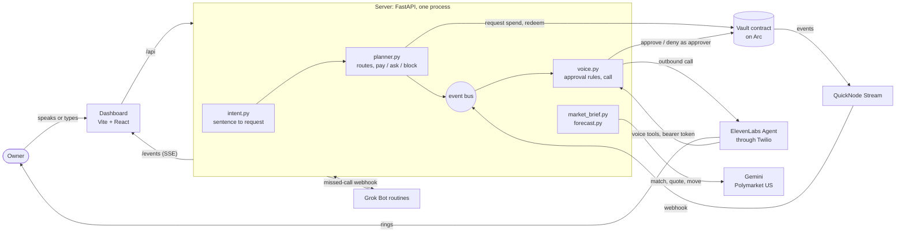

# Switchboard

Tell it where you want your money to go, in plain speech, and a crew of agents moves it across
wallets, chains, banks and prediction markets, inside limits a contract enforces, phoning you
when something needs your say.

Built for the University Blockchain Conference 2026 Hackathon.

## What works today

This branch is the voice and surface half (P2). The money half (P1: the vault contract, real
transfers, the QuickNode Stream, the venue clients) is developed separately and is stubbed
here, so everything below runs with no chain, no venue account and no phone.

| Piece | State on this branch |
|---|---|
| Sentence to transfer request | Real. One LLM call (Anthropic), cross-checked by a rule-based parser; rules alone without a key |
| Route planner, pay / ask / block | Real logic. Fee and time figures are estimates in `server/fixtures/rails.json` until P1 measures them |
| Vault policy, permits, approvals, freeze | **Stub** (`server/app/chain/stub.py`), same rules as the contract, in memory |
| Transfers | **Stub**: pretends to send, then to arrive. No funds move |
| Approval call | Real code, **dry run** by default: the request that would go to ElevenLabs is logged and the dashboard stands in for the phone. Real calls need `CALLS_ENABLED=true` and an agent |
| Approval rules (amount, word, passkey, expiry, call cap) | Real |
| Prices and equivalence check | **Recorded data** (`server/fixtures/markets.json`), a snapshot of pairs on Gemini and Polymarket US. `scripts/phase0_markets.py` reads the live public APIs |
| Position move | **Dry run only.** No order is ever placed from this branch. `TRADING_ENABLED` is false and the stub ignores it anyway |
| Forecast opinion | Real: four model families on live calls, when the keys are set |
| Forecast receipts | Real hashing, reveal and Brier scoring. The onchain commitment is a **stub** |
| Grok Bot routines | Server routes are real. The routines are set up by hand: [bots/routines.md](bots/routines.md) |
| Kalshi, Limitless, Phantom | **Planned.** Listed in the markets panel as not connected. Nothing is built for them |

## Quick start

Needs [uv](https://docs.astral.sh/uv/) (it installs Python 3.12), Node 20 or later, and pnpm
(`npm install -g pnpm`).

```
git clone https://github.com/subatomic-hamster/switchboard.git
cd switchboard
cp .env.example .env

cd server
uv sync
uv run python -m app            # the server, on http://127.0.0.1:8787
```

In a second terminal:

```
cd switchboard/web
pnpm install
pnpm dev                        # the dashboard, on http://localhost:5173
```

In a third, with the dashboard open:

```
cd switchboard/server
uv run python -m app.demo_mock  # replays a full day; add --fast to skip the pauses
```

With `.env` copied unchanged, every integration is in dry-run or fixture mode and nothing
needs a key. To build the dashboard into the server instead of running Vite:
`cd web && pnpm build`, then open http://127.0.0.1:8787.

### The demo path by hand

1. Type or say "Move two hundred dollars from my Ethereum wallet to Sam's Solana wallet". The
   operator quotes the cheapest and the fastest route. Send it: a particle passes through the
   ring.
2. "Send 250 from my Arc wallet to Sam's Arc wallet". It is over the limit: the particle stops
   at the ring, and "Needs your say" shows the request, both sides of the argument and a
   one-time word. Approve by giving the amount and the word, or deny.
3. "Move my Rockets position from Polymarket to Gemini". The markets panel shows both venues'
   prices, the match result and the cost. Pick the Bitcoin market to see a refusal.
4. Safety controls: kill the stream or freeze, then try a transfer. Change a rule by voice.
   Paste hostile text into "Try to trick it".
5. Flight recorder: replay the day on the ring.

### Checks

```
cd server && uv run pytest && uv run ruff check . && uv run ruff format --check . && uv run mypy
cd web && pnpm test && pnpm typecheck
```

`web/src/api-types.ts` is generated from the server's OpenAPI document and never edited by
hand. After changing `server/app/schemas.py` or a route:
`cd server && uv run python -m scripts.gen_api_types`.

## Architecture



On this branch the vault, the Stream and the venues are the stubs described above. P2's code
reaches P1's only through the four protocols in `server/app/ports.py`, so the real modules drop
in without changes on this side.

| Path | What it is |
|---|---|
| `server/app/schemas.py` | Pydantic models for every body and event: the shared interface |
| `server/app/events.py` | In-process event bus, `/events` (SSE) with replay, stored history |
| `server/app/intent.py`, `planner.py` | Sentence to request; routes, quote, decision, execution |
| `server/app/voice.py`, `agent_config.py`, `passkey.py` | The approval call, its rules, the agent's prompt and tools, the passkey check |
| `server/app/market_brief.py`, `forecast.py` | The markets operator, the multi-model forecast and its receipts |
| `server/app/rules.py`, `hostile.py`, `bots.py` | Rules by voice, the hostile-content box, Grok Bot routes |
| `server/app/chain/stub.py`, `markets/stub.py` | **Stubs** for P1's modules |
| `server/scripts/` | `gen_api_types`, `create_agent`, and the two Phase 0 proofs |
| `web/src/` | The dashboard |
| `bots/` | Routine definitions and chat exports |
| `docs/` | The product plan, the implementation plan, and the unattended-run prompts |

## The decision loop

1. **The owner's sentence is parsed** into an amount, a source and a destination. One LLM
   call with structured output, no tools, and it sees only that sentence. Its answer is checked
   against a rule-based parse of the same sentence: the amount must match, and a destination
   address must appear in the sentence character for character. The model cannot invent
   either.
2. **The planner fixes the route** before anything from outside is read. It finds the cheapest
   and the fastest route over the available rails and quotes both, with cost and time.
3. **The planner asks the vault.** It never signs for the vault; it requests a spend. Every
   request resolves to one of three outcomes, each with a reason code:

   | Outcome | When | What happens |
   |---|---|---|
   | **pay** | Within the per-transfer limit and the daily budget, to a payee on the allowlist | The vault issues a single-use permit; the transfer starts |
   | **ask** | `OVER_TRANSFER_CAP`, `OVER_DAILY_BUDGET` or `PAYEE_NOT_ALLOWED` | The vault holds a pending request; the owner's phone rings |
   | **block** | `FROZEN`, `STREAM_STALE`, `CALL_CAP_REACHED` | Nothing is requested and nothing rings |

4. **The owner decides on the call**, and the answer settles the request onchain.
5. **Everything is published once** on the event bus: to the dashboard, to the stored log
   (which the flight recorder replays), and to the daily summary.

### Safety limits

| Limit | Default | Where it is enforced |
|---|---|---|
| Per-transfer limit | $200 | Vault contract |
| Rolling 24-hour budget | $500 | Vault contract |
| Payee allowlist | The wallet book | Vault contract |
| Freeze (kill switch) | Off | Vault contract; by voice, or on the dashboard |
| Stale-Stream pause | Spending stops while the Stream is quiet | Server, before the vault is asked |
| Approval expiry | 5 minutes, then denied | Vault contract and server |
| Approval calls per day | 5, then requests are denied without a call | Server |
| Passkey threshold | Above $1,000, a passkey as well as the call | Server |
| Order size | `MAX_ORDER_USD` = $2, and a hard ceiling of $2 in code | Before any order call |
| Trading switch | `TRADING_ENABLED` = false | Before any order call |

Defaults are in `.env.example`. The owner can change the first three by voice (below); the
agent's key can never change them.

Circle's nanopayments need a signature from an ordinary key, so the vault cannot pay those
directly. The agent's wallet holds a small balance that the vault tops up only by redeeming a
permit. The worst case is one top-up misspent, bounded by the per-transfer limit.

### The approval call

When the vault holds a request, the server stores it with a one-time word, shows the word on
the owner's dashboard, and calls the owner's registered number. Two voices speak on every
call: the operator states the request and the case for it, and the risk officer gives one
objection. To approve, the owner must:

- say the **amount** back, exactly;
- say the **word on their screen**. The word is never sent to the voice agent, in a call
  variable, a tool response or an event, so someone who only hears the call cannot learn it;
- above the passkey threshold, also confirm with a **passkey** on the dashboard. The passkey
  challenge is bound to that one request.

"Yes" is not an approval. Three wrong attempts deny the request. No answer, a call that ends
without a decision, or the expiry passing, denies it. Saying "freeze" stops all spending and
needs no word, because stopping is always safe.

Nothing authenticates by voice. A cloned voice gains nothing: calls go out only to the
registered number, and approval needs the word from the owner's screen.

The dashboard stays on the machine running the server. ElevenLabs and the bots reach the
server through a public tunnel, so only four prefixes are served to requests from outside, and
each checks its own credential: `/api/voice/` and `/api/bots/` (bearer tokens), `/api/hooks/`
(HMAC) and `/api/health`. Everything else, including the route that shows the word, is refused
unless the request was addressed to localhost and did not come through a proxy
(`server/app/local_only.py`).

Against rubber-stamping: the dashboard shows the approval rate and warns when every request
has been approved, and calls are capped per day.

### Rules by voice

"Raise my transfer limit to 300." The sentence is parsed by fixed patterns, not a model, so
what is read back is exactly what will be applied. Loosening a rule needs the word from the
owner's screen; tightening one needs only "confirm". The change goes through the vault's
owner-only `setPolicy`.

### Prompt injection

Outside content (web pages, market descriptions, bot research, model rationales) only reaches
code that has no ability to move money, and its output is stored and shown as unverified text.
The "Try to trick it" box demonstrates the worst case: it asks the vault for exactly what the
hostile text demands, as a hijacked agent would. The result is a phone call the owner can
refuse, a denial at the call cap, or, if the demand is inside every limit and to a payee
already trusted, one capped transfer. That last case is the stated bound on a hijacked agent;
the demonstration reports it and does not execute it.

## ElevenLabs

| Product | How it is used |
|---|---|
| **Agents** (conversational AI) | The approval line: one agent with the two-persona prompt in `server/app/agent_config.py` |
| **Outbound calling through Twilio** | `POST /v1/convai/twilio/outbound-call`, with per-call dynamic variables for the amount, payee, reason and both cases |
| **Server (webhook) tools** | Nine tools pointing at this server, each sending a bearer token held as a workspace secret: `get_request`, `approve`, `deny`, `freeze`; `list_markets`, `market_brief`, `market_override`; `propose_rule`, `confirm_rule` |
| **Multi-voice** | The risk officer speaks in a second voice (`<RiskOfficer>` tags) when `ELEVENLABS_RISK_OFFICER_VOICE_ID` is set; otherwise one voice announces each speaker |
| **Post-call webhooks** | `call_initiation_failure` and `post_call_transcription`, verified by HMAC, turn an unanswered or undecided call into a denial |
| **System tools** | `end_call` and `voicemail_detection` |

Set up: `cd server && uv run python -m scripts.create_agent --dry-run` prints everything that
would be sent; `--apply` creates it; `--list` shows agent and phone-number ids. If the plan
does not allow phone calls, the ElevenLabs browser widget can host the same agent
(`<elevenlabs-convai agent-id="…" dynamic-variables='{"request_id":"7"}'>`); the voice tools
are unchanged.

The dashboard's own microphone input and read-back use the browser's speech recognition and
synthesis, not ElevenLabs.

## Grok Bot

Grok Bots do the research and the watching; they never move money. Four routines run on their
own: one messages the owner when an approval call goes unanswered (triggered by a webhook from
this server), one posts the day's summary on a schedule, one researches whether two markets
settle the same way using X search, and one reconciles the ledger against the vault each day.
A bot's token opens read-only routes and two note-taking routes; it is rejected by every route
that approves, sends, freezes or changes a limit. What a bot writes is stored as unverified
outside content: a research note is shown next to the equivalence check and never changes its
verdict.

The exact text of each routine, its trigger and its setup are in
[bots/routines.md](bots/routines.md). Chat exports go in `bots/exports/`.

## Markets

Positions cannot be transferred between venues. A "move" is a sale on one and a purchase on
the other.

- **Same bet or not.** P1's check compares five fields in code: the event, the threshold, the
  direction, the event time, and who decides the outcome. If any differs, the move is refused
  and the reason is spoken ("different price index").
- **The cost of moving** is arithmetic from two order books: sell now and pay the taker fee,
  or post an ask and wait, which makes the sale a maker order.
- **"Will I get a bid?"** is read from bid depth and spread. It is a fact.
- **"I'd hold this"** is a forecast. One model from each of at least three families
  (Anthropic, OpenAI, Google, xAI) estimates the probability, starting from the market price;
  the answers are averaged in log-odds and pulled halfway back to the market. With fewer than
  three families answering there is no opinion. The owner can override it.
- **Receipts.** Each opinion is hashed with a salt and the hash is committed before the event.
  Afterwards it is revealed and scored with the Brier score, next to the market price's own
  score on the same events. That is the track record shown beside every opinion.

**The forecast is a second opinion from language models with a published track record. It is
not financial advice.**

The cash leg of a move is not automated: neither venue documents a withdrawal endpoint that
fits, so a balance is held on both and the rebalance is shown as a queued instruction. The
original sequence (sell, withdraw, deposit, re-buy) remains the production design once
withdrawals can be automated.

## Configuration

Everything is in `.env` (copy `.env.example`). `.env` takes priority over variables already in
the shell. A blank value always means dry run or fixtures, never a failure to start.

| Variable | For |
|---|---|
| `ANTHROPIC_API_KEY`, `INTENT_MODEL` | The intent parser. Blank: rules only |
| `OPENROUTER_API_KEY` (or `OPENAI_API_KEY`, `GOOGLE_AI_API_KEY`, `XAI_API_KEY`), `FORECAST_MODELS` | The forecast. Fewer than three families: no opinion |
| `ELEVENLABS_API_KEY`, `ELEVENLABS_AGENT_ID`, `ELEVENLABS_PHONE_NUMBER_ID`, `OWNER_PHONE_NUMBER`, `CALLS_ENABLED` | Real approval calls. All five are needed |
| `ELEVENLABS_WEBHOOK_SECRET` | Verifying post-call webhooks |
| `VOICE_TOKEN`, `BOT_TOKEN` | Bearer tokens for the voice tools and for bot routes. Generate long random values |
| `PUBLIC_BASE_URL` | The server's public HTTPS address (a tunnel), for webhooks and voice tools |
| `GROK_MISSED_CALL_WEBHOOK_URL` | Where to report a missed call |
| `POLICY_*`, `PASSKEY_THRESHOLD_USD`, `APPROVAL_EXPIRY_S`, `MAX_CALLS_PER_DAY` | The limits |
| `TRADING_ENABLED`, `MAX_ORDER_USD` | The real-money guards. Leave as they are |
| `USE_P1_STUBS` | `true` until P1's modules are wired in |

## P1 sections

These belong to the money half and are filled in on its branch.

- **Contract addresses and how Arc is used**: to come with the vault deployment.
- **QuickNode Stream configuration** (network, dataset, filter, destination): to come.
- **Gemini endpoints used**: to come with the venue clients. The Phase 0 proof on this branch
  reads `GET https://api.gemini.com/v1/prediction-markets/events` and
  `GET https://gateway.polymarket.us/v1/markets` (public, no key).
- **Bank on-ramp** (sandbox): to come.

## Documents

| File | What it is |
|---|---|
| [docs/product-plan.md](docs/product-plan.md) | What the product does, the safety design, sponsor tools, demo script |
| [docs/implementation-plan.md](docs/implementation-plan.md) | Roles for two people, stack, repo layout, shared interface, phases |
| [docs/prompts/](docs/prompts/) | Prompts for unattended Claude Code runs on each half |
| [bots/routines.md](bots/routines.md) | Grok Bot routines |
| [OVERNIGHT_LOG.md](OVERNIGHT_LOG.md) | What was built on this branch, what is blocked, decisions, and what needs a person |
