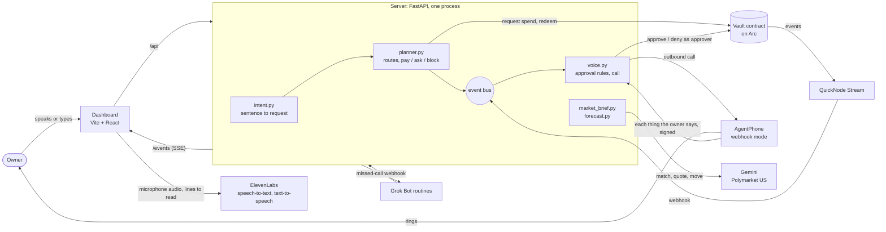

# Switchboard

Tell it where you want your money to go, in plain speech, and a crew of agents moves it across
wallets, chains, banks and prediction markets, inside limits a contract enforces, phoning you
when something needs your say.

Built for the University Blockchain Conference 2026 Hackathon.

## What works today

Switchboard has two halves: the voice and surface half, and the money half (the vault,
cross-chain transfers, the QuickNode Stream, escrow, the venue clients). The money half runs
live on testnets only, and only when switched on. With `.env` copied unchanged it uses the
in-memory stubs, so everything runs with no chain, no venue account and no phone. No real money
is involved anywhere: Arc testnet, Ethereum Sepolia and Solana devnet USDC have no value.

States: **Live on Arc testnet**, **Live public data** (real venue endpoints, no keys),
**Dry run** (the real request is built and logged, nothing is sent), **Stub** (in memory),
**Blocked** (needs access we do not have).

| Piece | State |
|---|---|
| Sentence to transfer request | Real. One LLM call (Anthropic), cross-checked by a rule-based parser; rules alone without a key |
| Route planner, pay / ask / block | Real logic. Fees and times in `server/fixtures/rails.json` are Circle's fee API figures for CCTP (quoted 20 Nov 2026); the forward-and-mint time (30 s) and some native-transfer costs are estimates |
| Vault policy, permits, approvals, freeze | **Live on Arc testnet** with `USE_P1_STUBS=false` ([Contracts](#contracts-on-arc-testnet)). The in-memory stub (`server/app/chain/stub.py`) is the default |
| Vault events to the server | **Live**: a QuickNode Stream on Arc testnet, HMAC-verified, with a dead man's switch ([QuickNode Stream](#quicknode-stream)) |
| Transfer on Arc | **Live on Arc testnet**: the vault pays the payee. Checked on 20 Nov 2026 |
| Transfer to Ethereum Sepolia, Solana devnet | **Live on testnet** with `USE_REAL_TRANSFERS=true`: Circle CCTP V2, one transfer each checked ([Cross-chain](#cross-chain-transfers-cctp-v2)). Only Arc-origin routes. Stub otherwise |
| USDC to EURC (StableFX) | **Blocked**: permissioned, needs an API key from Circle. Code written, dry-run quotes only |
| Bank on-ramp | **Blocked**: needs a Circle Mint sandbox account. Not built |
| Escrow, claim links, payment requests | **Live on Arc testnet**: commit-reveal claim and refund after expiry checked ([Escrow](#escrow-and-payment-requests)). Claim link host depends on `PUBLIC_BASE_URL` |
| Safety depth (dead man's switch, anomaly baseline) | Real, with tests. Checked live: stale at start, clear on the first heartbeat; pausing the Stream in QuickNode blocks spending within 90 s |
| Approval call | Real code, **dry run** by default: the request that would be sent is logged and the dashboard stands in for the phone. The phone call goes through **AgentPhone** (`CALL_PROVIDER=agentphone`); an ElevenLabs agent through Twilio is the alternative. **No real call has been placed yet**, so the call itself is untested end to end |
| Dashboard voice (microphone, quote read back) | Real: ElevenLabs speech-to-text and text-to-speech when `ELEVENLABS_API_KEY` is set, checked with one live round trip; the browser's own speech otherwise |
| Approval rules (amount, word, passkey, expiry, call cap) | Real |
| Connected assistants (ChatGPT, Claude, Grok and others sending through Switchboard) | Real server code, checked on this machine with the official MCP client. **No assistant has been connected for real**: that needs a public address. See [Connected assistants](#connected-assistants) |
| Prices and equivalence check | **Live public data** with `USE_REAL_MARKETS=true` (Gemini and Polymarket US, no keys). **Recorded data** otherwise (`server/fixtures/markets.json`). Tests use recordings in `server/fixtures/markets/` |
| Position move | **Dry run only.** Both legs are built and signed with a dummy key, never sent. `TRADING_ENABLED` is false, no venue keys are set, and no order has been placed |
| Trade records onchain | Ledger deployed on Arc testnet. With the real vault and `LEDGER_ADDRESS` set, each move, dry or not, is hashed onto it; stub anchor otherwise. Checked live: a dry-run move of 2 contracts wrote Ledger entry 1 (tx `0x68b0…5969`) |
| Forecast opinion | Real: four model families on live calls, when the keys are set |
| Forecast receipts | Real hashing, reveal and Brier scoring. The commitment goes onto the Ledger with the real vault and `LEDGER_ADDRESS` (a stub anchor otherwise). Checked live: a four-model opinion on an NBA game was committed as Ledger entry 2 before tip-off; the reveal comes after the game |
| Grok Bot routines | Server routes are real. The routines are set up by hand: [bots/routines.md](bots/routines.md) |
| Kalshi, Limitless, Phantom | **Planned.** Listed in the markets panel as not connected. Nothing is built for them |

## Quick start

Needs [uv](https://docs.astral.sh/uv/) (it installs Python 3.12), Node 20 or later, and pnpm
(`npm install -g pnpm`).

```
git clone https://github.com/subatomic-hamster/switchboard.git
cd switchboard
cp .env.example .env

cd server
uv sync
uv run python -m app            # the server, on http://127.0.0.1:8787
```

In a second terminal:

```
cd switchboard/web
pnpm install
pnpm dev                        # the dashboard, on http://localhost:5173
```

In a third, with the dashboard open:

```
cd switchboard/server
uv run python -m app.demo_mock  # replays a full day; add --fast to skip the pauses
```

With `.env` copied unchanged, every integration is in dry-run or fixture mode and nothing
needs a key. To build the dashboard into the server instead of running Vite:
`cd web && pnpm build`, then open http://127.0.0.1:8787.

### Running against Arc testnet

Needs [Foundry](https://book.getfoundry.sh/) (`forge`, and `anvil` for some tests).

```
cd contracts && forge build         # also writes the ABIs the server reads; required for the real vault
cd server
uv run python -m app                # with USE_P1_STUBS=false and the settings under Configuration
cloudflared tunnel --url http://127.0.0.1:8787
```

Then point the QuickNode Stream's webhook destination at `<tunnel url>/api/hooks/quicknode`
(a quick tunnel gets a new address each time it starts). Until the first heartbeat arrives the
server treats the Stream as stale and refuses to spend. The server starts with
`USE_P1_STUBS=false` only if the vault address, RPC URL and the three keys are set. Switching
from stubs to the real vault needs a fresh database: the contract numbers requests from 1, and
a stub-era row with the same number would swallow a real request.

### The demo path by hand

1. Type or say "Move two hundred dollars from my Ethereum wallet to Sam's Solana wallet". The
   operator quotes the cheapest and the fastest route. Send it: a particle passes through the
   ring.
2. "Send 250 from my Arc wallet to Sam's Arc wallet". It is over the limit: the particle stops
   at the ring, and "Needs your say" shows the request, both sides of the argument and a
   one-time word. Approve by giving the amount and the word, or deny.
3. "Move my Rockets position from Polymarket to Gemini". The markets panel shows both venues'
   prices, the match result and the cost. Pick the Bitcoin market to see a refusal.
4. Safety controls: kill the stream or freeze, then try a transfer. Change a rule by voice.
   Paste hostile text into "Try to trick it".
5. Flight recorder: replay the day on the ring.

### Checks

```
cd server && uv run pytest && uv run ruff check . && uv run ruff format --check . && uv run mypy
cd web && pnpm test && pnpm typecheck
cd contracts && forge test
```

Tests marked `anvil` need `~/.foundry/bin` on `PATH` and a built `contracts/out`. Tests marked
`live` hit the real public Gemini and Polymarket US endpoints and are skipped by default:
`cd server && uv run pytest -m live`.

`web/src/api-types.ts` is generated from the server's OpenAPI document and never edited by
hand. After changing `server/app/schemas.py` or a route:
`cd server && uv run python -m scripts.gen_api_types`.

## Architecture



The server reaches the vault, transfers, the anchor and the venues only through the four
protocols in `server/app/ports.py`. Each has a stub (the default) and a real module, chosen by
the settings under Configuration.

| Path | What it is |
|---|---|
| `server/app/schemas.py` | Pydantic models for every body and event: the shared interface |
| `server/app/events.py` | In-process event bus, `/events` (SSE) with replay, stored history |
| `server/app/intent.py`, `planner.py` | Sentence to request; routes, quote, decision, execution |
| `server/app/voice.py`, `call_script.py`, `passkey.py` | The approval call and its rules, the scripted conversation for the AgentPhone call, the passkey check |
| `server/app/agent_config.py`, `speech.py` | The ElevenLabs agent's prompt and tools (Twilio path and browser widget); ElevenLabs speech for the dashboard |
| `server/app/market_brief.py`, `forecast.py` | The markets operator, the multi-model forecast and its receipts |
| `server/app/rules.py`, `hostile.py`, `bots.py` | Rules by voice, the hostile-content box, Grok Bot routes |
| `server/app/connectors.py`, `mcp_http.py`, `holds.py` | Connected assistants: keys and limits, the MCP endpoint, and requests held for the owner in front of the vault |
| `server/app/chain/` | `vault.py`, `stream.py`, `watchdog.py`, `anomaly.py`, `transfer.py` (CCTP), `escrow.py`, `anchor.py`, `fx.py`; `stub.py` is the in-memory stand-in |
| `server/app/markets/` | `gemini.py`, `polymarket.py`, `match.py`, `quote.py`, `move.py`, `real.py`; `stub.py` is the stand-in |
| `contracts/`, `server/quicknode/filter.js` | `Vault.sol`, `Ledger.sol`, `Escrow.sol` (Foundry); the Stream filter |
| `server/scripts/` | `gen_api_types`, `agentphone_setup`, `create_agent`, `widget_page`, and the two Phase 0 proofs |
| `web/src/` | The dashboard |
| `bots/` | Routine definitions and chat exports |
| `docs/` | The product plan, the implementation plan, and the unattended-run prompts |

## The decision loop

1. **The owner's sentence is parsed** into an amount, a source and a destination. One LLM
   call with structured output, no tools, and it sees only that sentence. Its answer is checked
   against a rule-based parse of the same sentence: the amount must match, and a destination
   address must appear in the sentence character for character. The model cannot invent
   either.
2. **The planner fixes the route** before anything from outside is read. It finds the cheapest
   and the fastest route over the available rails and quotes both, with cost and time.
3. **The planner asks the vault.** It never signs for the vault; it requests a spend. Every
   request resolves to one of three outcomes, each with a reason code:

   | Outcome | When | What happens |
   |---|---|---|
   | **pay** | Within the per-transfer limit and the daily budget, to a payee on the allowlist | The vault issues a single-use permit; the transfer starts |
   | **ask** | `OVER_TRANSFER_CAP`, `OVER_DAILY_BUDGET` or `PAYEE_NOT_ALLOWED` | The vault holds a pending request; the owner's phone rings |
   | **block** | `FROZEN`, `STREAM_STALE`, `CALL_CAP_REACHED` | Nothing is requested and nothing rings |

4. **The owner decides on the call**, and the answer settles the request onchain.
5. **Everything is published once** on the event bus: to the dashboard, to the stored log
   (which the flight recorder replays), and to the daily summary.

### Safety limits

| Limit | Default | Where it is enforced |
|---|---|---|
| Per-transfer limit | $200 | Vault contract |
| Rolling 24-hour budget | $500 | Vault contract |
| Payee allowlist | The wallet book | Vault contract |
| Freeze (kill switch) | Off | Vault contract; by voice, or on the dashboard |
| Stale-Stream pause | Spending stops while the Stream is quiet | Server, before the vault is asked |
| Approval expiry | 5 minutes, then denied | Vault contract and server |
| Approval calls per day | 5, then requests are denied without a call | Server |
| Per-assistant limit | Asks every time, until the owner sets an amount | Server, in front of the vault |
| Approval requests per assistant | 3 a day and one at a time, then refused without a call | Server |
| Passkey threshold | Above $1,000, a passkey as well as the call | Server |
| Order size | `MAX_ORDER_USD` = $2, and a hard ceiling of $2 in code | Before any order call |
| Trading switch | `TRADING_ENABLED` = false | Before any order call |

The defaults above are the stub's. The vault deployed on Arc testnet runs a smaller policy so
test money stays small: $5 per transfer, $10 per rolling 24 hours, 600 s approval expiry.
The owner can change the first three by voice (below); the agent's key can never change them.

Circle's nanopayments need a signature from an ordinary key, so the vault cannot pay those
directly. The agent's wallet holds a small balance that the vault tops up only by redeeming a
permit. The worst case is one top-up misspent, bounded by the per-transfer limit.

### The approval call

When the vault holds a request, the server stores it with a one-time word, shows the word on
the owner's dashboard, and calls the owner's registered number. The operator states the
request and the case for it, and the risk officer gives one objection. To approve, the
owner must:

- say the **amount** back, exactly;
- say the **word on their screen**. The word is never sent to the voice agent, in a call
  variable, a tool response or an event, so someone who only hears the call cannot learn it;
- above the passkey threshold, also confirm with a **passkey** on the dashboard. The passkey
  challenge is bound to that one request.

"Yes" is not an approval. Three wrong attempts deny the request. No answer, a call that ends
without a decision, or the expiry passing, denies it. Saying "freeze" stops all spending and
needs no word, because stopping is always safe.

Nothing authenticates by voice. A cloned voice gains nothing: calls go out only to the
registered number, and approval needs the word from the owner's screen.

**Which path the phone call uses.** `CALL_PROVIDER` picks who places it:

| `CALL_PROVIDER` | What happens |
|---|---|
| `dry_run` (default) | No call. The request that would be sent is logged, and the dashboard stands in for the phone through the same checks |
| `agentphone` | **The phone call.** `POST https://api.agentphone.ai/v1/calls` in webhook mode. AgentPhone turns the owner's speech into text and posts each turn to `POST /api/voice/hooks/agentphone`; this server decides what is said back. The conversation is a fixed script in `server/app/call_script.py`: no language model is on the call, so nothing said on it can talk the line into anything |
| `elevenlabs_twilio` | An ElevenLabs agent called through Twilio (`POST /v1/convai/twilio/outbound-call`), using the voice tools on this server. Kept and tested with mocked HTTP; not what the demo uses, because Twilio is a paid line |

All three end in the same `approve`, `deny` and `freeze` code, so the rules above do not
depend on the provider. Whatever `CALL_PROVIDER` says, no call is placed unless
`CALLS_ENABLED=true` and everything the provider needs is set; the server logs what is
missing at start-up.

The AgentPhone webhook accepts a delivery only with a valid `X-Webhook-Signature` (HMAC-SHA256
of the timestamp and the raw body) no more than five minutes old, and only for a call this
server placed. Someone ringing the number, even from the owner's caller id, is told nothing
can be approved and the line hangs up. A call that has not reached a decision after twelve
turns is denied.

Known limits of the AgentPhone call:

- **One voice.** AgentPhone gives one voice per call, so the risk officer is announced by
  name ("Now the risk officer") in the same voice as the operator. The two-voice version
  exists only on the ElevenLabs agent.
- **Approvals only.** Rules by voice and the markets operator are tools of the ElevenLabs
  agent. On an AgentPhone call they are not available; a rule is confirmed on the dashboard.
- **Speech-to-text decides what was heard.** The amount is read from digits or words ("two
  fifty" is asked again, because it has two readings). The word is matched against the
  public list of possible words, so "harbour" is read as "harbor"; whether it is the right
  word is still checked only against the one stored for that request.
- **If the owner does not pick up**, the opening line (amount, payee, reason) is what a
  voicemail would record. The word is never spoken by the server.

The dashboard stays on the machine running the server. AgentPhone, ElevenLabs and the bots
reach the server through a public tunnel, so only four prefixes are served to requests from
outside, and each checks its own credential: `/api/voice/` (bearer token for the voice tools,
HMAC for the two call webhooks), `/api/bots/` (bearer token), `/api/hooks/` (HMAC) and
`/api/health`. Everything else, including the route that shows the word, is refused
unless the request was addressed to localhost and did not come through a proxy
(`server/app/local_only.py`).

Against rubber-stamping: the dashboard shows the approval rate and warns when every request
has been approved, and calls are capped per day.

### Rules by voice

"Raise my transfer limit to 300." The sentence is parsed by fixed patterns, not a model, so
what is read back is exactly what will be applied. Loosening a rule needs the word from the
owner's screen; tightening one needs only "confirm". The change goes through the vault's
owner-only `setPolicy`. The sentence can be spoken into the dashboard's microphone; the
confirmation is given on the dashboard, or on a call when the ElevenLabs agent hosts it.

### Prompt injection

Outside content (web pages, market descriptions, bot research, model rationales) only reaches
code that has no ability to move money, and its output is stored and shown as unverified text.
The "Try to trick it" box demonstrates the worst case: it asks the vault for exactly what the
hostile text demands, as a hijacked agent would. The result is a phone call the owner can
refuse, a denial at the call cap, or, if the demand is inside every limit and to a payee
already trusted, one capped transfer. That last case is the stated bound on a hijacked agent;
the demonstration reports it and does not execute it.

## ElevenLabs

ElevenLabs is used wherever speech does not need a phone line, and is kept as an alternative
for the part that does.

| Product | How it is used | State |
|---|---|---|
| **Speech-to-text** | The dashboard's microphone: the recording goes to `POST /v1/speech-to-text` and the text comes back into the sentence box for the owner to check | Live when `ELEVENLABS_API_KEY` is set |
| **Text-to-speech** | The operator's voice on the dashboard: the quote read back, a rule read back, the markets brief, the day's summary (`POST /v1/text-to-speech/{voice}`) | Live when the key is set |
| **Agents** (conversational AI) | The approval conversation with two personas, prompt in `server/app/agent_config.py`. Runs in the **browser widget** as the fallback when no phone line is available, and on the phone when `CALL_PROVIDER=elevenlabs_twilio` | Built; the agent is created by `scripts/create_agent.py --apply` and has not been created yet |
| **Server (webhook) tools** | Nine tools pointing at this server, each sending a bearer token held as a workspace secret: `get_request`, `approve`, `deny`, `freeze`; `list_markets`, `market_brief`, `market_override`; `propose_rule`, `confirm_rule` | With the agent |
| **Multi-voice** | On the agent, the risk officer speaks in a second voice (`<RiskOfficer>` tags) when `ELEVENLABS_RISK_OFFICER_VOICE_ID` is set | With the agent |
| **Outbound calling through Twilio, post-call webhooks** | `POST /v1/convai/twilio/outbound-call` and the HMAC-verified `call_initiation_failure` / `post_call_transcription` webhooks | Only with `CALL_PROVIDER=elevenlabs_twilio` |

**The phone call does not use ElevenLabs.** It is placed through AgentPhone, in AgentPhone's
voice, because Twilio is a paid line. The plan's endpoint
(`POST /v1/convai/twilio/outbound-call`) is still in the code behind
`CALL_PROVIDER=elevenlabs_twilio`.

Both dashboard speech routes (`/api/speech/say`, `/api/speech/hear`) hold the key on the
server and are served to this machine only. With no key, or if ElevenLabs refuses a request,
the dashboard falls back to the browser's own speech recognition and synthesis; the
microphone button's tooltip says which one is in use.

**Browser widget fallback.** With the agent created and a tunnel open:

```
cd server
uv run python -m scripts.create_agent --apply --write-env   # once; writes to your ElevenLabs account
uv run python -m scripts.widget_page 7 --open               # request 7, as shown on the dashboard
```

The second command writes a standalone page under `data/` that runs the agent in the
ElevenLabs widget with that request's variables, and opens it. The agent states the request,
argues it, and calls the same `approve` / `deny` / `freeze` tools. The page is kept apart from
the dashboard on purpose: the widget is third-party script, and the dashboard shows the
one-time word.

## AgentPhone

The approval call. One agent and one number on the account are used as they are; nothing here
creates an agent or buys a number.

```
cd server
uv run python -m scripts.agentphone_setup --write-env         # read-only: finds the agent and number ids
uv run python -m scripts.agentphone_setup --set-webhook-mode  # changes the agent: voiceMode = webhook
uv run python -m scripts.agentphone_setup --register-webhook  # changes the agent: points its webhook here
```

`--register-webhook` needs `PUBLIC_BASE_URL` set to the server's public HTTPS address (for
example `cloudflared tunnel --url http://localhost:8787`). It registers
`PUBLIC_BASE_URL/api/voice/hooks/agentphone` as the agent's webhook and saves the signing
secret AgentPhone returns in `.env` without printing it. Run the first command again at any
time to see what is still missing. Then set `OWNER_PHONE_NUMBER`, `CALL_PROVIDER=agentphone`
and, when the phone should really ring, `CALLS_ENABLED=true`, and restart the server.

What the call sounds like:

1. *"This is the Switchboard operator, an automated call about your own account. Your agent
   wants to send 250 dollars to Sam's Arc wallet. It needs your approval because it is over
   your per-transfer limit."*
2. After anything the owner says: the operator gives the case for it (the owner's own
   sentence), then *"Now the risk officer"* gives one objection, then the operator asks for the
   amount and the word on the dashboard.
3. *"Two hundred and fifty dollars, ocean."* The server checks both and answers
   *"Approved"*, or says which one did not match and how many tries are left.

"Deny" and "freeze" work at any point. The API key is sent to `api.agentphone.ai` and to no
other host; the address is a constant in the code, not a setting.

## Connected assistants

Other assistants can use Switchboard to send, and to hand out your receiving addresses:
ChatGPT, Claude, Grok, Gemini, or anything else that speaks MCP or plain HTTP. You connect
one on the dashboard ("Connected assistants"), where it gets its own key and its own limit.

**What a connected assistant can do**

| Tool | What it does |
|---|---|
| `switchboard_status` | Its limit, what it has sent today, who it can pay, whether spending is paused |
| `switchboard_quote` | Price a transfer and say what would happen. Sends nothing |
| `switchboard_send` | Ask for a transfer to a payee in the wallet book |
| `switchboard_transfers` | Look up transfers it asked for itself |
| `switchboard_receive` | Your receiving addresses, one per chain |

**What it can never do**, whatever a web page, a file or someone in its chat tells it:
approve anything, see the one-time word, pay an address that is not in your wallet book,
change a limit, add a payee, unfreeze the vault, or see another assistant's requests. There
is no route for any of these, so there is nothing to talk it into.

**How a request is decided.** It goes through the same planner and the same vault as your
own sentence. Two things are added in front:

- **Its own limit.** Each assistant has "without asking, up to" and "in a day, up to". A new
  connector starts at 0, which means it asks you every time. A transfer the vault would
  allow, but that is over the assistant's limit, is held: you get the same approval call,
  with the amount and the word, and the vault is asked only after you say yes.
- **A cap on asking.** One assistant can have you asked 3 times in 24 hours and once at a
  time. Past that its requests are refused without a call, so it cannot use up the day's
  calls or wear you down.

On the call the operator says where the request came from ("your connected assistant
ChatGPT asked for it; it did not come from a sentence you spoke"). Nothing the assistant
wrote is read out.

The assistant's limit is kept by this server. The vault contract knows one agent key, so a
limit per assistant is not enforced onchain; the vault's own limits are.

**Two ways to connect**

| | Address | Credential |
|---|---|---|
| Key | `PUBLIC_BASE_URL/api/connect/mcp` | `Authorization: Bearer <key>` |
| Secret address | `PUBLIC_BASE_URL/api/connect/link/<key>/mcp` | The address itself |

A key works one way only: a key-type key is refused in an address, and the other way round.
The secret address exists because several assistants' own settings take an address and
nothing else. Anyone who has that address can act as that assistant, inside its limit, so
keep the limit low and revoke it on the dashboard if it gets out. Signing in with OAuth is
the better answer and is not built.

What each assistant accepts, from its documentation as read on 19 November 2026. **None of
these has been tried**, because that needs a public address:

| Assistant | How |
|---|---|
| ChatGPT | Developer mode, add a custom MCP server, no authentication, the secret address. Its settings have no field for a key. The OpenAI API takes the key as `authorization` |
| ChatGPT "dots" | They use what is already installed on the ChatGPT account, so the ChatGPT connector should cover them. Not confirmed |
| Claude | Custom connector with no sign-in and the secret address. Claude Code: `claude mcp add --transport http switchboard <address> --header "Authorization: Bearer <key>"`. The Messages API takes the key as `authorization_token` |
| Grok | grok.com/connectors, custom, the address. The xAI API takes the key as `authorization` |
| Gemini | Gemini CLI and API: the address with the key as a header. The Gemini app asks connectors to sign in with OAuth, so it cannot connect yet |
| Meta AI (Muse) | Connectors are a developer preview. What the app accepts could not be confirmed |
| Anything else | Any MCP client with the key, or the JSON routes below |

Without MCP, the same five operations are plain JSON routes under `/api/connect/v1`
(`status`, `quote`, `send`, `transfers`, `receive`) with the key as a bearer token.
`/api/connect/v1/openapi.json` describes them, for tools that import an OpenAPI document.

```
curl -H "Authorization: Bearer <key>" http://localhost:8787/api/connect/v1/status
curl -H "Authorization: Bearer <key>" -H "Content-Type: application/json" \
     -d '{"amount_usd": 20, "to": "sam"}' http://localhost:8787/api/connect/v1/send
```

**Known limits**

- **Receiving is addresses only.** Switchboard does not watch for incoming payments, so
  an assistant can give out your address but cannot confirm that money arrived.
- **Transfers are simulated** while `USE_P1_STUBS=true`, and the assistant is told so in
  every answer.
- The MCP protocol is handled by the official SDK (`mcp` 2.3), which serves both current
  stateless clients and older ones that open with a handshake. Only POST is answered.
- Making, changing and revoking connectors happens on the dashboard, which is served on
  this machine only. Only `/api/connect/` is reachable through the tunnel.

## Grok Bot

Grok Bots do the research and the watching; they never move money. Four routines run on their
own: one messages the owner when an approval call goes unanswered (triggered by a webhook from
this server), one posts the day's summary on a schedule, one researches whether two markets
settle the same way using X search, and one reconciles the ledger against the vault each day.
A bot's token opens read-only routes and two note-taking routes; it is rejected by every route
that approves, sends, freezes or changes a limit. What a bot writes is stored as unverified
outside content: a research note is shown next to the equivalence check and never changes its
verdict.

The exact text of each routine, its trigger and its setup are in
[bots/routines.md](bots/routines.md). Chat exports go in `bots/exports/`.

## Contracts on Arc testnet

Chain id 5042002, RPC `https://rpc.testnet.arc.io`. Source in `contracts/src/`, with Foundry
tests for all three (`contracts/test/`). All three are deployed.

| Contract | Address |
|---|---|
| Vault | [`0xf04A1A72848cD816A0E22D3aF62fc5d4288d4524`](https://testnet.arcscan.app/address/0xf04A1A72848cD816A0E22D3aF62fc5d4288d4524) |
| Ledger | [`0x75375b072Eea338C1AE65941Dfc4E9567aB13569`](https://testnet.arcscan.app/address/0x75375b072Eea338C1AE65941Dfc4E9567aB13569) |
| Escrow | [`0x12b1820011873d8E23A6679Ec26e9D61b4D2523D`](https://testnet.arcscan.app/address/0x12b1820011873d8E23A6679Ec26e9D61b4D2523D) |
| USDC (Arc's native ERC-20, 6 decimals) | [`0x3600000000000000000000000000000000000000`](https://testnet.arcscan.app/address/0x3600000000000000000000000000000000000000) |

The owner, agent, approver and Sam's wallet are burner testnet keys. Their addresses are in
[OVERNIGHT_LOG_P1.md](OVERNIGHT_LOG_P1.md); the keys are not in the repo.

| Contract | What it enforces |
|---|---|
| **Vault** | The agent key can only ask (`requestSpend`) and redeem a permit. Per-transfer cap, rolling 24-hour budget and payee allowlist are checked in the contract. Inside policy: a single-use permit that expires in 10 minutes. Outside it: a pending request with a deadline, reason 1 to 4 (over cap, over budget, payee not allowed, frozen). The owner or the approver approves (and the same transaction pays) or denies; anyone can expire a request after its deadline. Owner or approver can freeze; only the owner can unfreeze or change policy. Budget counts at permit issue, so an unredeemed permit holds budget for 24 hours |
| **Ledger** | Append-only commitments for forecast receipts and trade records. Only allowed writers (the agent) can `commit` a 32-byte hash and later `reveal` the preimage; a wrong preimage is refused. Accepts keccak256 or sha256 |
| **Escrow** | Holds USDC for a recipient with no wallet, released by a secret (claim link), refundable to the sender after expiry. Also payment requests (`request`, `pay`). Details [below](#escrow-and-payment-requests) |

**How Arc is used.**

- **USDC is the gas token.** Arc's native balance and the USDC ERC-20 are the same money
  (18 decimals as gas, 6 as ERC-20). The agent wallet needs no separate gas token, only a small
  USDC float. The contracts handle 6-decimal amounts only.
- **Blocks are about 0.5 s.** A standard CCTP burn on Arc is attested after one block, so no
  fast-transfer fee applies from Arc. The Stream heartbeat every 60 blocks is about 30 s.
- **Arc is CCTP domain 26**, and every live route starts there: the vault pays on Arc, then the
  agent burns on Arc.

## QuickNode Stream

The server learns what the vault did from a Stream, not by polling.

| Setting | Value |
|---|---|
| Name | `switchboard-vault-arc` |
| Network | Arc Testnet |
| Dataset | Logs |
| Filter | `server/quicknode/filter.js` (JavaScript) |
| Destination | Webhook, `<public tunnel>/api/hooks/quicknode` |
| Signing | The Stream's security token, set as `QUICKNODE_STREAM_SECRET` |
| Retries | Every 10 s, terminates after 10 failed retries (the maximum) |

**The filter** keeps only logs emitted by the Vault, Ledger and Escrow addresses. If a batch
holds none, it is skipped, except when the batch's start block is a multiple of 60: that one
delivers `{"heartbeat": n}`. A quiet vault and a dead Stream therefore look different.

**Verification** (`server/app/chain/stream.py`). A delivery needs three headers:
`X-QN-Nonce`, `X-QN-Timestamp` and `X-QN-Signature`, the HMAC-SHA256 of nonce, timestamp and the
decoded body under the security token. A gzip body is inflated first (capped at 10 MB, because
this happens before the check). Anything else is a 401.

- **Skew window:** a timestamp more than 300 s from the server clock is refused.
- **Replay guard:** a repeated (nonce, timestamp) inside the window is a 401. A delivery that
  failed halfway is removed from the guard, so QuickNode's retry with the same nonce is not
  refused (a 401 on every retry would terminate the Stream).
- **Duplicate logs** (transaction hash and log index) are published once. The guards are in
  memory and a restart forgets them.

**What it publishes.** `ApprovalRequested` becomes `approval.requested` (not for reason FROZEN);
`Resolved` becomes `approval.resolved`; `Frozen` becomes `frozen`; escrow and payment logs become
`escrow.updated` and `payment.updated`.

**Dead man's switch** (`server/app/chain/watchdog.py`). Any authenticated delivery, heartbeat or
logs, resets a timer. After `STREAM_STALE_AFTER_S` (default 90) of silence the server publishes
`stream.stale` and refuses to spend. At start-up there has been no delivery, so the Stream counts
as stale until the first heartbeat. An owner's approval is also not settled onchain while stale
(the request stays pending and may expire, which is the safe direction); a denial always is.
Checked live: restart published stale, the first heartbeat cleared it. Pausing the Stream in
QuickNode turned it stale 90 s after the last delivery and a spend previewed `block`
(`STREAM_STALE`); resuming cleared it in 9 s.

## Cross-chain transfers (CCTP V2)

Circle's CCTP V2, burn on Arc, with Circle's Forwarding Service submitting the mint on the
destination, so neither side needs destination gas. With `USE_REAL_TRANSFERS=true` the planner
offers only the rails marked `"live": true` in `server/fixtures/rails.json`.

1. The vault pays the **agent wallet** on Arc, exactly the amount. (A Sepolia address looks like
   an Arc address, so the planner tells the vault the destination chain and the vault is never
   asked to pay an address on the wrong chain.)
2. The agent burns the amount plus the forwarding fee on Arc (`depositForBurnWithHook`,
   `minFinalityThreshold` 2000, the standard attestation). The fee is quoted from Circle's fee
   API just before the burn and comes out of the agent's float, so the recipient gets the full
   amount.
3. Circle attests (Iris sandbox, polled), then forwards the mint. The server publishes
   `transfer.sent`, `transfer.attested` and `transfer.arrived` with the real hashes.

**Checked live** (times are as logged)

| Route | Result |
|---|---|
| "send 1 dollar from my arc wallet to my ethereum wallet" (Arc to Sepolia) | Burn `0xfaf3…e49f` on Arc at 06:48:40, attested 06:48:46, forwarded mint `0x668d…cfc2` on Sepolia at 06:51:42. The owner's Sepolia USDC went from 0 to 1.000000 |
| Arc to Solana devnet | Burn `0x5249…6778` (1.214 USDC, including the forward fee and the token-account creation), attested and minted 7 s later (`4chE6dAM…nMox6`). The Solana wallet holds 1 USDC on devnet |
| Arc to Arc | Vault pays the payee directly. Checked on 20 Nov 2026: "move 6 dollars from my arc wallet to sam's arc wallet" was over the cap, the approval call (dry run) was answered with amount and word, and the vault paid Sam 6 USDC |

Fee and timing sources, contract addresses and every finding marked verified or inferred are in
[server/app/chain/RAILS.md](server/app/chain/RAILS.md).

**Not live**

- Routes that start on Sepolia or Solana: the vault and the agent are on Arc.
- `CCTP_FORWARD=false` (self-mint): Sepolia only, needs Sepolia ETH on the agent key. Unit-tested
  with a mocked mint. Solana self-mint is not built.
- **USDC to EURC (StableFX): blocked.** It is permissioned (an unauthenticated request returns
  401; a key comes from a Circle representative). `chain/fx.py` is written against the documented
  API, quotes from the public ECB mid-rate in dry run, and has no `execute`. The agent holds
  testnet EURC. Circle's Arc App Kit `swap()` is a documented account-free alternative, not run.
- Circle Gateway: researched, not built (it adds a deposit step and a second API client for the
  same result).
- A transfer in flight when the server restarts is not resumed. The burn is onchain and Circle
  forwards anyway; only the `transfer.arrived` event is missed.
- The direct route `POST /api/chain/transfer` answers 403 when transfers are real, because it
  skips the vault.
- Per-payee limits for cross-chain payees are enforced by the server and the planner preview, not
  the contract: the contract sees the agent as the payee.

## Escrow and payment requests

For a recipient with no wallet. The agent wallet deposits USDC into Escrow (the vault funds the
agent wallet first; Escrow is deliberately not a vault payee, because a bare transfer to it would
carry no claim hash and could never be claimed or refunded). The per-transfer cap is checked in
the route.

- **Claim link:** `<PUBLIC_BASE_URL>/claim#<id>:<secret>`. The secret is random; only its
  keccak256 goes onchain, and the part after `#` is never sent to a server. Default expiry is
  7 days.
- **Commit-reveal claim.** A secret seen in the mempool must not be usable to redirect funds, so
  claiming takes two transactions: `commitClaim` records a hash of (id, secret, destination),
  then `claim` in a later block pays that destination only if exactly that commitment exists. A
  copied secret cannot pay a bot. The server relays both with the agent key (so it pays the gas)
  and checks the secret first, so a wrong secret costs nothing.
- **Refund:** anyone can trigger it after expiry; it pays the sender's refund address. Before
  expiry it reverts.
- **Payment requests:** `request(payer, amount, memo)` and `pay(id)`, once; a named payer only,
  or anyone if none.
- **In the dashboard:** "No wallet? Send a link" on Home (amount, expiry, copy the link). The
  recipient's page at `/claim` shows the amount, takes an Arc address and claims. It and
  `POST /api/escrow/peek` (amount and expiry, only for the secret's holder) are reachable through
  the tunnel without a token; the rest of the dashboard and the escrow routes stay on this
  machine.
- Routes: `POST /api/escrow/create`, `/claim`, `/peek`, `/requests`, `/requests/{id}/pay`,
  `/{id}/refund`, and `GET /api/escrow/{id}`.

**Checked live.** A $1 escrow (1) was created (`0xdfc8…efbe`) and claimed to Sam
with the secret (`0xc17d…6a10`, Sam +1 USDC); a replayed claim and a refund both reverted
`AlreadySettled`. Escrow 2: a refund before expiry reverted `NotExpired`, and after expiry it paid
back (`0xc059…18fd`). Escrow 3 went through the browser end to end: a $1 link made on Home,
opened, claimed to Sam (`0x5d73…e78e`); reopening it said "already been claimed". A $0.50
payment request was made and paid (`0x1e06…3d5e`, `0x39e2…c271`); paying it again reverted
`AlreadyPaid`. Payment requests have no dashboard screen yet (API only). Claim links use `PUBLIC_BASE_URL`, so it must point at the current tunnel.

## Safety depth

Three things beyond the vault's fixed limits, all of which can only make the owner be asked
more, never approve or loosen anything.

- **Dead man's switch.** Above, under [QuickNode Stream](#quicknode-stream).
- **Anomaly baseline** (`server/app/chain/anomaly.py`). A hijacked agent can stay under fixed caps:
  fifty dollars to a new address at 3 a.m. after weeks of two-dollar payments. Each spend is scored
  against what the agent has actually sent. If it looks wrong, a spend the vault would allow
  becomes an approval call, with the reason as the risk officer's objection. On by default with
  the real vault (`ANOMALY_ENABLED` overrides). Nothing is flagged until
  `ANOMALY_MIN_SAMPLES` (8) spends exist. Any one rule flags:

  | Rule | Flags when |
  |---|---|
  | Amount | At least `ANOMALY_AMOUNT_FACTOR` (5) times the median spend and, if the history varies, a robust z-score of at least 3.5 (median absolute deviation) |
  | Payee | An address this agent has never paid |
  | Burst | Payment number `ANOMALY_BURST_COUNT` (4) or more inside `ANOMALY_BURST_WINDOW_S` (600 s) and faster than any burst in the history |
  | Hour | A UTC hour at least 3 hours from every hour the agent has spent in |

- **Adversarial tests.** The safety work added 24 adversarial tests and 3 Foundry tests (per
  the run log). `server/tests/test_adversarial.py` covers replayed permits, a wrong payee, the
  agent key changing rules, replayed, reused-nonce, stale, future and tampered Stream deliveries,
  a bounded replay cache, injected text, split transfers against an assistant's limit, and
  spending while frozen or stale (an approval waits, a denial does not). The dead man's switch and
  the anomaly baseline have their own files, `test_watchdog.py` and `test_anomaly.py`.

## Markets

Positions cannot be transferred between venues. A "move" is a sale on one and a purchase on
the other.

**Endpoints used**

| Venue | Public, no key (used with `USE_REAL_MARKETS=true`) | Signed (built and tested, dry run) |
|---|---|---|
| Gemini (`https://api.gemini.com`) | `GET /v1/prediction-markets/events` (paged), `GET /v1/prediction-markets/events/{ticker}`, `GET /v1/book/{instrumentSymbol}` | `POST /v1/prediction-markets/order`, `/order/cancel`, `/positions`, `POST /v1/balances`; HMAC-SHA384 headers |
| Polymarket US (`https://gateway.polymarket.us`) | `GET /v1/market/slug/{slug}`, `GET /v1/markets`, `GET /v1/markets/{slug}/book`, `GET /v1/markets/{slug}/bbo`, `GET /v1/search` | On `https://api.polymarket.us`: `POST /v1/orders`, `POST /v1/order/{id}/cancel`, `GET /v1/account/balances`, `GET /v1/portfolio/positions`, private WebSocket for fills; Ed25519 headers |

Signing was tested against openssl vectors. No signed request has been sent to either venue.
Recorded responses used by the tests, with their provenance and one synthetic file, are in
[server/fixtures/markets/README.md](server/fixtures/markets/README.md).

- **Same bet or not.** `server/app/markets/match.py` compares five fields in code: the event, the
  strike, the direction, the event time, and who settles it. If any is `different`, the move is
  refused and the reason is spoken ("different price index"). It also refuses when the event,
  strike, direction or time is `unknown`, because an unverified field could buy the wrong thing.
  Seen on live data, 20 Nov 2026: NBA and La Liga winners match; Bitcoin above a strike is refused
  (Gemini settles on a Lukka index, Polymarket on CF Benchmarks' BRTI); San Francisco's daily
  high is refused (the bands are offset by one degree); the team total versus game total refusal
  is checked on a synthetic Polymarket side, because no such market was listed.
- **The cost of moving** is arithmetic from two order books: sell now and pay the taker fee, or
  post an ask and wait, which makes the sale a maker order. The buy is always a taker order. Taker
  fee = rate x contracts x price x (1 - price). Polymarket US rate 0.095 (the plan, and the
  `feeCoefficient` on every market read on 20 Nov 2026), makers pay nothing. Gemini rate 0.07 for
  contracts listed on or after 18 Mar 2026 ([Gemini's prediction fees](https://www.gemini.com/fees/predictions));
  older contracts follow a legacy 0.05 schedule that is not modelled.
- **The move is a dry run.** It builds and signs both legs with a dummy key and logs them; a
  guard order is fixed: minimum 0.01 contract, notional at most `MAX_ORDER_USD` (hard ceiling $2),
  then `TRADING_ENABLED`. Outcomes are `filled`, `partial`, `unfilled`, `stranded` or `dry_run`.
  Every move, dry or not, ends in a hash of the trade record committed to the Ledger. Gemini
  trades settle on Gemini; the Ledger entry is the record. A real-money move has not been run;
  a dry-run move on live order books has (orders signed with dummy keys, logged, never sent).
- **"Will I get a bid?"** is read from bid depth and spread. It is a fact.
- **"I'd hold this"** is a forecast. One model from each of at least three families
  (Anthropic, OpenAI, Google, xAI) estimates the probability, starting from the market price;
  the answers are averaged in log-odds and pulled halfway back to the market. With fewer than
  three families answering there is no opinion. The owner can override it.
- **Receipts.** Each opinion is hashed with a salt and the hash is committed before the event.
  Afterwards it is revealed and scored with the Brier score, next to the market price's own
  score on the same events. That is the track record shown beside every opinion.

**The forecast is a second opinion from language models with a published track record. It is
not financial advice.**

The cash leg of a move is not automated: neither venue documents a withdrawal endpoint that
fits, so a balance is held on both and the rebalance is shown as a queued instruction. The
original sequence (sell, withdraw, deposit, re-buy) remains the production design once
withdrawals can be automated.

## Configuration

Everything is in `.env` (copy `.env.example`). `.env` takes priority over variables already in
the shell. A blank value always means dry run or fixtures, never a failure to start.

| Variable | For |
|---|---|
| `ANTHROPIC_API_KEY`, `INTENT_MODEL` | The intent parser. Blank: rules only |
| `OPENROUTER_API_KEY` (or `OPENAI_API_KEY`, `GOOGLE_AI_API_KEY`, `XAI_API_KEY`), `FORECAST_MODELS` | The forecast. Fewer than three families: no opinion |
| `CALL_PROVIDER`, `CALLS_ENABLED`, `OWNER_PHONE_NUMBER` | Who places the approval call (`dry_run`, `agentphone`, `elevenlabs_twilio`), whether a call may be placed at all, and the only number it may go to |
| `AGENTPHONE_API_KEY`, `AGENTPHONE_AGENT_ID`, `AGENTPHONE_NUMBER_ID`, `AGENTPHONE_WEBHOOK_SECRET` | The AgentPhone call. All four are needed; `scripts.agentphone_setup` fills in the last three |
| `ELEVENLABS_API_KEY` | Dashboard speech-to-text and text-to-speech. Blank: the browser's speech |
| `ELEVENLABS_AGENT_ID`, `ELEVENLABS_PHONE_NUMBER_ID`, `ELEVENLABS_WEBHOOK_SECRET`, `ELEVENLABS_*_VOICE_ID` | The ElevenLabs agent: the browser widget fallback, and the `elevenlabs_twilio` call |
| `VOICE_TOKEN`, `BOT_TOKEN` | Bearer tokens for the voice tools and for bot routes. Generate long random values |
| `PUBLIC_BASE_URL` | The server's public HTTPS address (a tunnel), for webhooks and voice tools |
| `GROK_MISSED_CALL_WEBHOOK_URL`, `GROK_MISSED_CALL_WEBHOOK_KEY` | The missed-call routine's webhook address and key |
| `POLICY_*`, `PASSKEY_THRESHOLD_USD`, `APPROVAL_EXPIRY_S`, `MAX_CALLS_PER_DAY` | The limits |
| `TRADING_ENABLED`, `MAX_ORDER_USD` | The real-money guards. Leave as they are |
| `USE_P1_STUBS` | `true` (default): in-memory vault, transfers and anchor. `false`: the real vault on Arc; the next five rows then apply |
| `VAULT_ADDRESS`, `ARC_RPC_URL`, `ARC_CHAIN_ID`, `USDC_ADDRESS` | The deployed vault and the chain. Chain id defaults to 5042002 and USDC to Arc's address; the address and RPC URL are required with the real vault |
| `OWNER_PRIVATE_KEY`, `AGENT_PRIVATE_KEY`, `APPROVER_PRIVATE_KEY` | The three roles: owner (policy, unfreeze), agent (asks, redeems, burns, relays escrow), approver (approves, denies, freezes). Required with the real vault. Testnet burners only; never commit them |
| `QUICKNODE_STREAM_SECRET` | The Stream's security token. Without it every delivery is rejected |
| `STREAM_STALE_AFTER_S` | Silence before spending pauses. Default 90 |
| `LEDGER_ADDRESS`, `ESCROW_ADDRESS` | The Ledger (receipts, trade records) and Escrow. Blank: stub anchor, and the escrow routes answer 503 |
| `USE_REAL_TRANSFERS` | CCTP V2 transfers from Arc. Needs `USE_P1_STUBS=false`; ignored otherwise |
| `CCTP_FORWARD` | Default true: Circle's Forwarding Service mints on the destination. `false` mints from this server, Sepolia only |
| `IRIS_URL`, `CCTP_POLL_INTERVAL_S`, `CCTP_TIMEOUT_S`, `ETH_SEPOLIA_RPC_URL`, `ETH_SEPOLIA_CHAIN_ID` | Attestation service (sandbox by default), polling, and the self-mint path only |
| `STABLEFX_API_KEY` | Blank: dry-run quotes from the public ECB mid-rate. A key alone does not enable trading |
| `USE_REAL_MARKETS` | Live public data from Gemini and Polymarket US. Blank or false: recorded fixtures |
| `GEMINI_API_KEY`, `GEMINI_API_SECRET`, `POLYMARKET_ACCESS_KEY`, `POLYMARKET_PRIVATE_KEY` | Venue trading keys. Orders stay dry run unless `TRADING_ENABLED` is true and all four are set. None are set |
| `ANOMALY_ENABLED`, `ANOMALY_MIN_SAMPLES`, `ANOMALY_AMOUNT_FACTOR`, `ANOMALY_BURST_COUNT`, `ANOMALY_BURST_WINDOW_S` | The anomaly baseline. Unset `ANOMALY_ENABLED` means on with the real vault, off with stubs. Defaults 8, 5, 4, 600 |
| `WALLETS_PATH` | The wallet book. Blank: `server/fixtures/wallets.json` (testnet burners we control) |

`.env.example` lists only some of the money-half settings (the vault address, RPC URL, Stream
secret and venue keys). Add the others by hand, with the names above, which are exactly those in
`server/app/config.py`.
## Live versus sandboxed

| Thing | Where it runs | State |
|---|---|---|
| Vault, Ledger, Escrow | Arc testnet | Live (testnet USDC, no value) |
| Vault events | QuickNode Stream, Arc Testnet | Live, HMAC-verified |
| Arc to Arc transfer | Arc testnet | Live |
| Arc to Sepolia, Arc to Solana devnet | CCTP V2 via Circle's sandbox Iris | Live on testnet, one transfer each checked |
| Escrow claim and refund | Arc testnet | Live |
| Approval phone call | AgentPhone | Dry run by default; no real call placed yet |
| Market prices, order books, equivalence check | Gemini and Polymarket US public APIs | Live public data (`USE_REAL_MARKETS=true`) |
| Orders on Gemini, Polymarket US | Not sent | Dry run; `TRADING_ENABLED=false`, no venue keys |
| Trade records | Ledger on Arc testnet | Written by dry-run moves with the real vault; stub anchor otherwise |
| USDC to EURC (StableFX) | Circle, permissioned | Blocked: needs an API key from Circle |
| Bank on-ramp | Circle Mint sandbox | Blocked: needs a sandbox account; not built |
| Sepolia or Solana as the source chain | n/a | Not live: the vault and agent are on Arc |
| Kalshi, Limitless, Phantom | n/a | Planned, not built |

## Documents

| File | What it is |
|---|---|
| [docs/product-plan.md](docs/product-plan.md) | What the product does, the safety design, sponsor tools, demo script |
| [docs/implementation-plan.md](docs/implementation-plan.md) | Roles for two people, stack, repo layout, shared interface, phases |
| [docs/prompts/](docs/prompts/) | Prompts for unattended Claude Code runs on each half |
| [bots/routines.md](bots/routines.md) | Grok Bot routines |
| [OVERNIGHT_LOG.md](OVERNIGHT_LOG.md) | What was built for the voice and surface half, what is blocked, decisions, and what needs a person |
| [OVERNIGHT_LOG_P1.md](OVERNIGHT_LOG_P1.md) | The money half: deployed addresses, live checks with hashes, decisions, blocked items, how to run |
| [server/app/chain/RAILS.md](server/app/chain/RAILS.md) | Research on CCTP, Gateway and StableFX: what is verified, inferred, unknown, with sources |
| [server/fixtures/markets/README.md](server/fixtures/markets/README.md) | Recorded market fixtures and where each came from |
